# habla_fluido

## screenshots

### Ronda 1. Preparar el proyecto y los permisos
**Rojo**

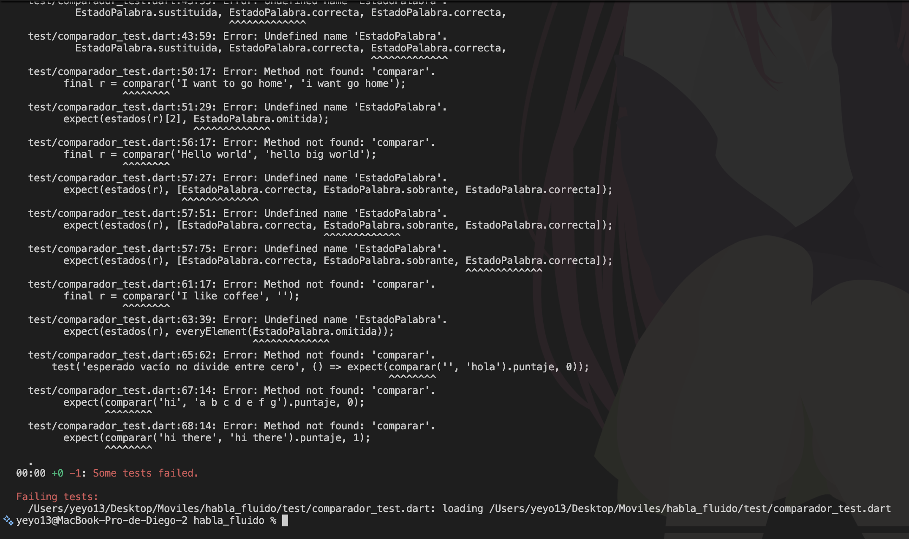

**Verde**

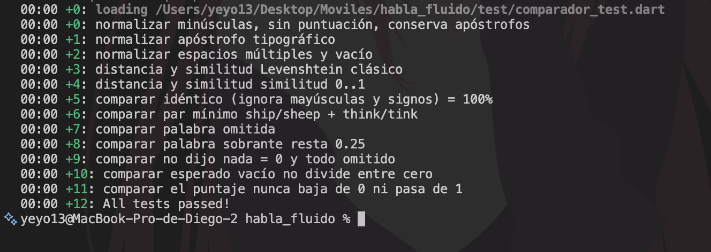

### Ronda 2. El comparador: ¿qué tan bien lo dijiste?
**Rojo**

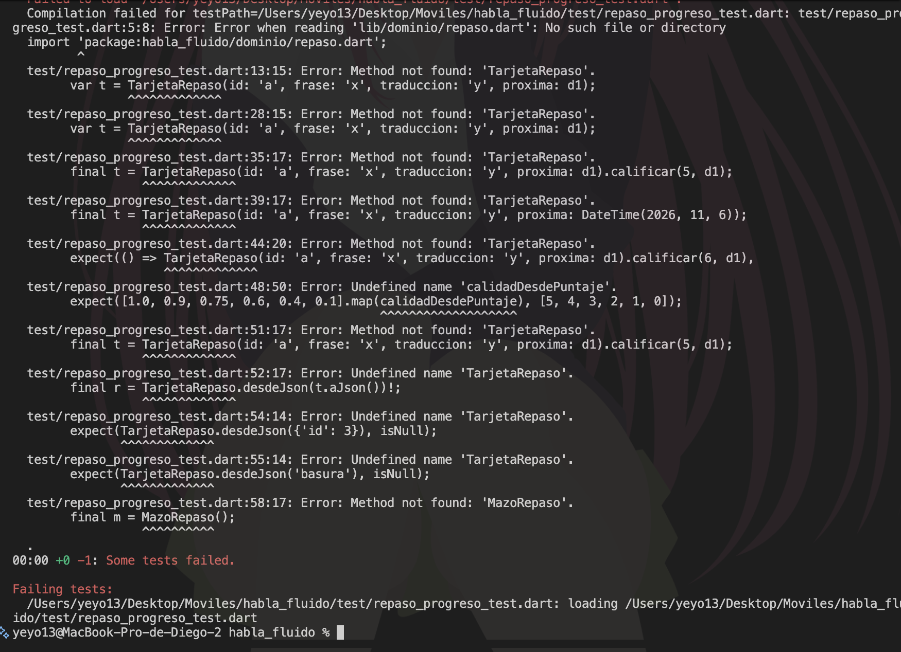

**Verde**

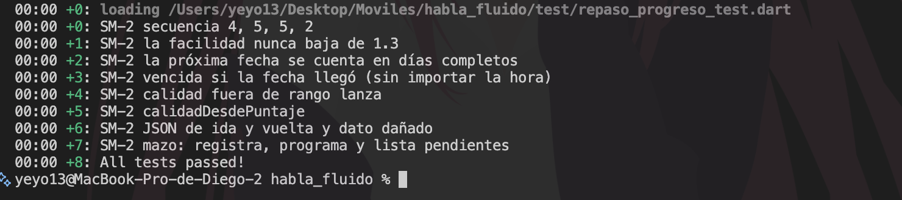

### Ronda 3. Repetición espaciada con SM-2
**Rojo**

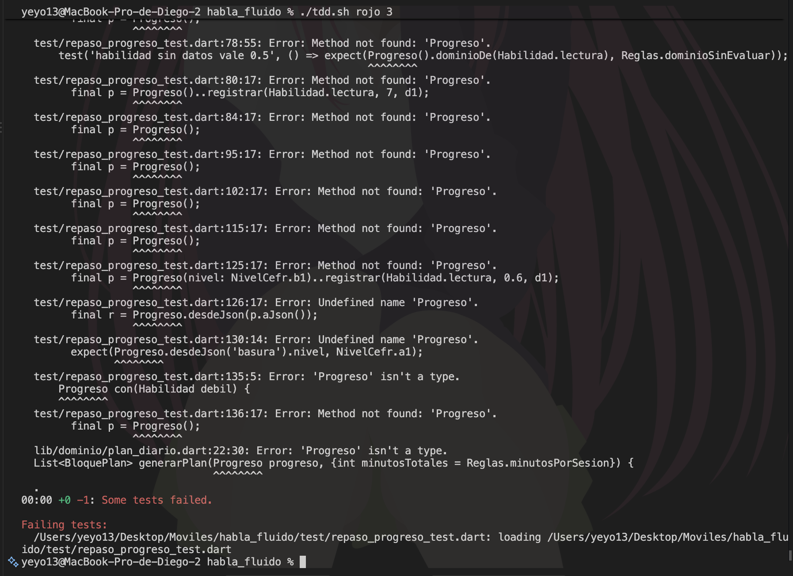

**Verde**

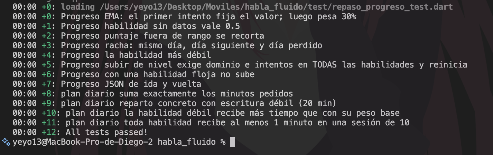

### Ronda 4. Progreso, nivel y plan diario
**Rojo**

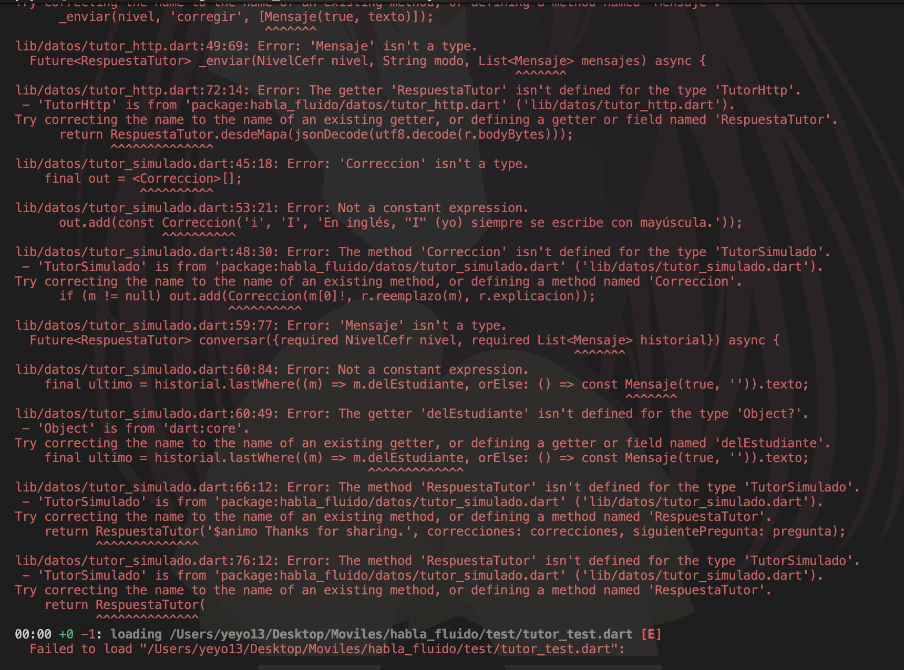

**Verde**

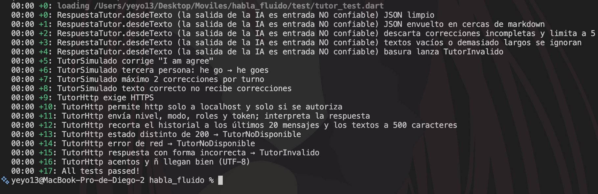

### Ronda 5. Contenido: frases, lecturas y el contrato del tutor
**Rojo**

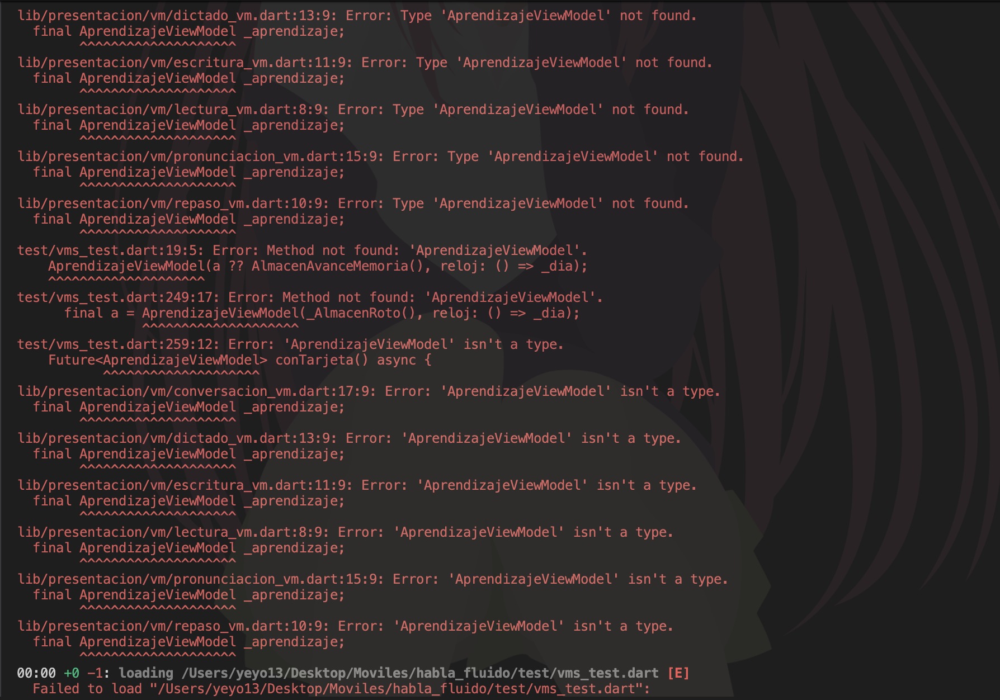

**Verde**

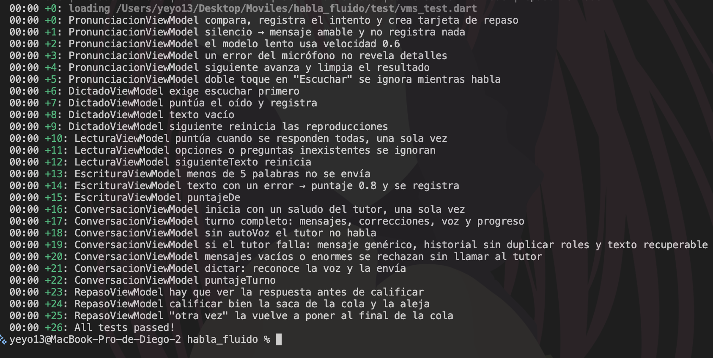

### Captura final
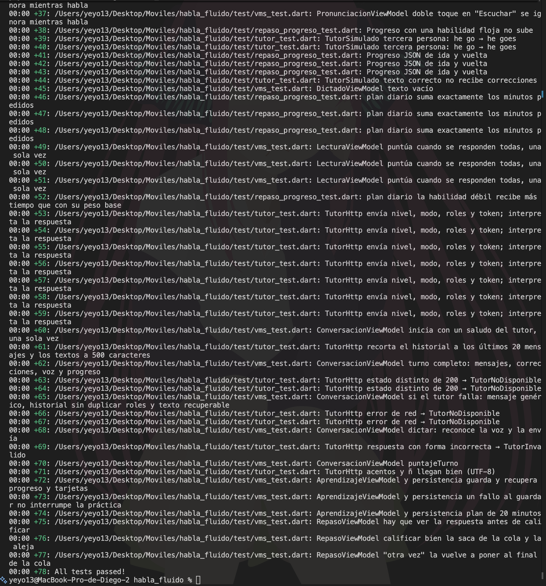

### Ronda 2. El comparador
**Rojo**
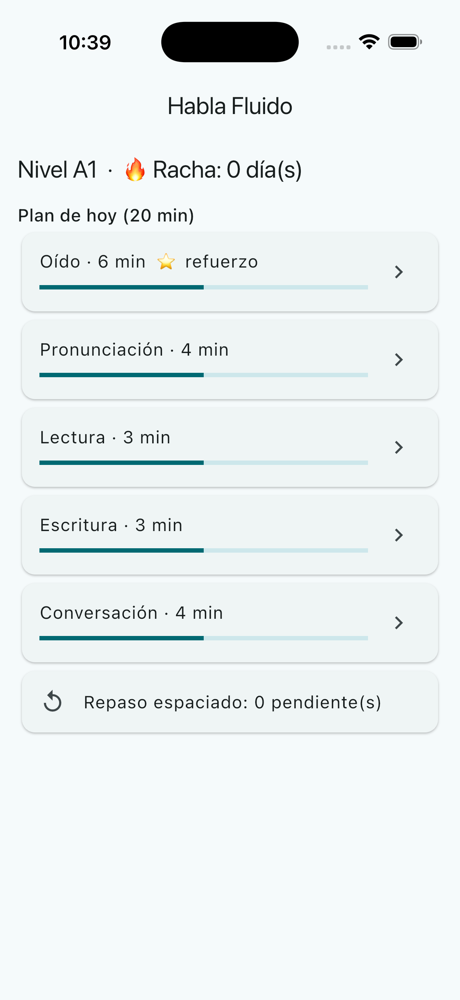
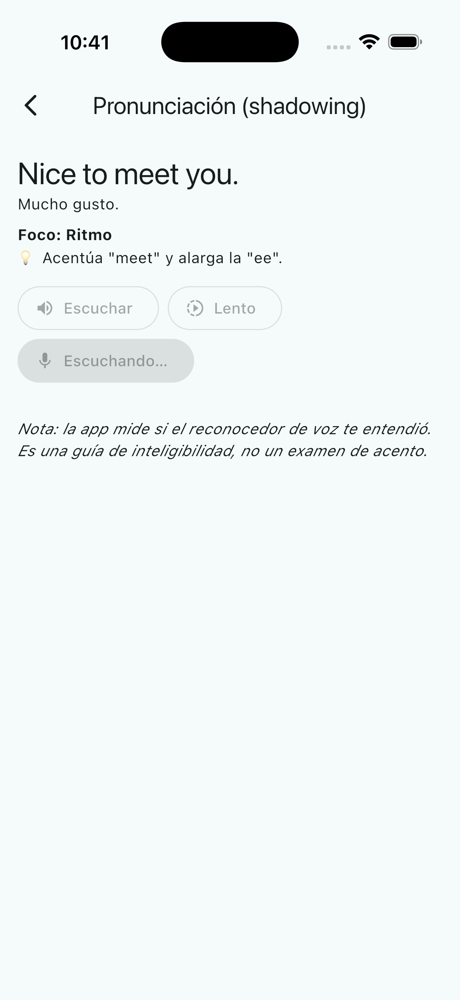
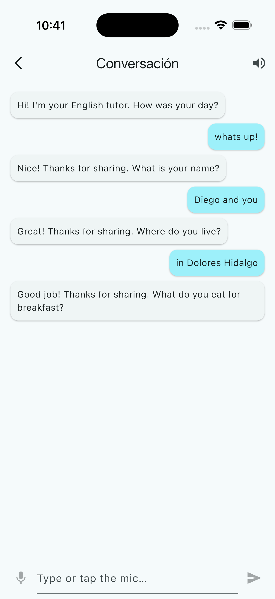